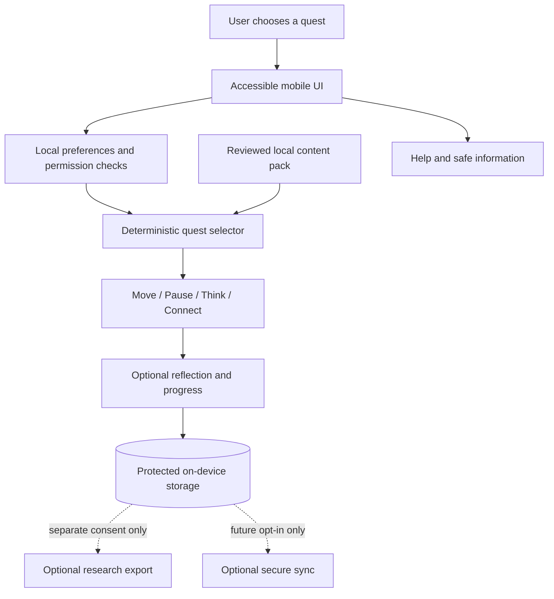

# QuestMind 3.0 — Privacy-First Everyday Thinking & Habits Game

**Status:** Proposed product and research plan, not an implemented or validated application  
**Version:** 3.0-design-2026-10-25  
**Owner:** To assign  
**Companion artifacts:** [`log.md`](log.md) (audit and decisions), [`QuestMind_Checklist.md`](QuestMind_Checklist.md) (actionable tasks)

> **One-sentence pitch:** QuestMind is a game you play with your day: move a little, put your phone down by choice, practice one useful thinking skill, connect respectfully, and notice what worked.

## 0. What we are building, and what we are NOT building

**We are building:** a lightweight, offline-first, optional daily game for practicing attention habits, flexible thinking, everyday problem-solving, constructive action, and intentional technology use. It focuses on behaviors and educational skills that users can practice in ordinary life.

**We are not building:** a doctor, therapy service, diagnostic screening tool, clinical risk prediction engine, an IQ-increasing device, or a system that secretly measures 25 psychological traits. No promise of treating anxiety, depression, ADHD, trauma, or any condition. Being non-medical does **not** excuse misleading claims or unsafe product design.

**North-star outcome:** a person can apply a useful skill in real life without needing to open the app. Healthy reduced app use can be a success.

**Early audience:** consenting adults, with university-aged and early-career participants as a reasonable first usability cohort. The long-term design should be accessible to people with varied ages, languages, devices, reading abilities, and mobility. Younger users should get separately reviewed age-appropriate experiences; there is no need to collect a complete birth date just to establish basic eligibility. Product design is jurisdiction-neutral in this document. Review relevant deployment obligations separately before shipping in any location; no country-specific regulations drive the design.

## 1. The 10 simple steps, each with rationale and a correction test

| Step | Decision / do this | Public rationale | Check / evidence required | If wrong, change this |
|---|---|---|---|---|
| 1 | Teach defined everyday skills, not infer hidden mental states | Directly teachable outcomes are clearer and more testable | Independent tasks and user comprehension | Narrow the claim or drop the skill |
| 2 | Keep one main daily quest; 60–90 seconds of **active screen use** | Low interaction burden helps the app support, rather than replace, daily life | Observed completion time and perceived effort | Shorten or split the quest |
| 3 | Let users select Move, Pause, or Think; never force all five every day | Choice protects autonomy and accessibility | Choice distribution, skips, qualitative feedback | Offer a simpler one-tap default |
| 4 | Use movement as an option, never the only currency | Mobility, illness and circumstance vary | Equivalent progression for non-walkers | Add alternatives and remove fixed quotas |
| 5 | Make phone-free time voluntary, with honest verification labels | Claiming a focus session occurred is different from proving it | Permission-denied flow and measurement audit | Use an explicitly self-reported completion |
| 6 | Teach one cognitive technique in each short Drop | Small educational objectives are easier to learn and test | Unseen scenario question, not same-game replay | Rewrite scenario or reduce complexity |
| 7 | Reward cumulative effort, not streak pressure or rejection | Avoid coercion, shame and dangerous incentives | Frustration and perceived-pressure tests | Remove the reward mechanic |
| 8 | Keep data on-device by default; no covert profiling | The basic product does not need a behavioral dossier | Offline use, export/delete, data-flow audit | Stop collection or redesign the feature |
| 9 | Use deterministic quest selection before any runtime AI | Fewer moving parts and stronger reviewability | Compare with simple nonpersonalized baseline | Retain simpler rules if AI adds no value |
| 10 | Validate outcomes against a credible comparison | More points in the game do not prove broader cognitive improvement | Preregistered independent and real-life outcomes | Narrow marketing claims, revise, or stop |

## 2. Five modules, designed as one coherent game

### 2.1 MOVE — Activity that fits the person

- **Experience:** choose a 3–10 minute walk, comfortable stretch, chair movement, standing break, or other accessible action; a short completion check adds a particle to the map.
- **Optional input:** permissioned step count, used locally as an activity cue. No automatic deduction of anxiety, mood, illness, or personal motivation from steps.
- **Why:** physical movement is a plausible and research-supported ingredient for cognitive wellbeing, but QuestMind's own effects must be measured.
- **Risks:** injury, overload, exclusion of people with mobility restrictions, device-sensor error, competitive pressure.
- **Test:** permission-denied completion, accessibility alternatives, user comfort, change in self-chosen activity versus baseline/control.
- **If wrong:** remove any absolute daily step goal, let users define manageable activities, or keep Move optional.

### 2.2 PAUSE — Voluntary digital balance

- **Experience:** a Quiet Quest offers a user-selected 5, 10, or 20 minute phone break or single-task focus period. Users can stop without penalty.
- **Verification:** user-confirmed (label **self-reported**) by default; optional device measurement may be used only where supported, consented and transparent (label **device-verified** with precise scope). Never imply the app monitors all device use.
- **Why:** the app should encourage actions that take place away from the screen rather than maximize its own usage.
- **Risks:** false measurement, interfering with urgent communication, guilt and coercive goals.
- **Test:** whether users understand verification limits, skip easily, and report genuinely useful breaks. Compare optional focus measurements to active controls.
- **If wrong:** remove device access, reduce quest duration, or replace the timer with a simple intention-setting card.

### 2.3 THINK — One small mental skill

- **Experience:** a 30–60 second Drop gives a familiar situation and asks for a helpful next action, explanation, or alternative perspective.
- **Skills:** distinguish predictions from facts; find one piece of evidence; break a large task into one startable step; identify alternatives; make an if-then plan; consider another perspective.
- **Example:** "I made one mistake; the whole project is doomed." The user chooses: "What evidence supports that? What is one thing to check?" Feedback teaches overgeneralization without interpreting the user's psychology.
- **Why:** this is educational practice of a well-defined thinking action, not a clinical assessment.
- **Measurement:** one previously unseen task after practice, plus optionally a real-life application prompt. Completing the same scenario repeatedly is *not* evidence of general mental improvement.
- **If wrong:** simplify wording, provide learning hints, add translation, or drop the exercise if it creates discomfort or shows no learning.

### 2.4 CONNECT — Optional real-world communication

- **Experience:** once weekly at most, offer safe prompts such as "thank someone," "ask a trusted person for one suggestion," or "share something you learned"; solo alternatives always exist.
- **Never:** require interaction with strangers, count rejections as points, pressure users into disclosure, rank social courage, or collect contacts.
- **Why:** everyday communication is valuable to practice, but personal context and safety matter more than competitive game mechanics.
- **Test:** perceived safety, choice and accessibility; no completion dependency.
- **If wrong:** replace with a private planning or perspective-taking exercise.

### 2.5 REFLECT — Notice usefulness, not diagnosis

- **Experience:** a one-sentence debrief with three choices: **Useful / Not useful / Skip** (and optionally a private sentence).
- **Data interpretation:** reactions describe perceived content usefulness; they do not estimate depression, withdrawal, emotional state, or personality.
- **Why:** the user controls whether the app's framing was helpful.
- **Test:** comprehension, felt pressure, feedback appropriateness, and whether optional reflections help learning.
- **If wrong:** replace evaluation prompts with a blank "done" button; do not force disclosure.

### 2.6 Optional extensions, only after MVP validation

- **Belief Forge:** an optional, educational evidence-checking pathway inspired by cognitive and REBT concepts; full steps are situation, belief, consequence, counterevidence, useful alternative. Never judge the user as irrational.
- **Skill Tree:** records objectively completed learning activities, not mental-health labels or ability rankings.
- **Arena:** an opt-in, low-stakes real-life experiment with prediction → action → reflection. No "collect rejection" mechanic and no mandatory timers.
- **Character and map:** cosmetic personalization and cumulative particles, no loss of progress.
- **Social squads:** defer; moderation, safety, and privacy risks are disproportionately large for an initial release.

## 3. A concrete 90-second daily journey

| Time on screen | User sees | What actually happens |
|---|---|---|
| 0–10 seconds | Map and one suggested quest; alternatives available | User chooses Move, Pause, or Think |
| 10–40 seconds | One short situation and 2–3 options | User makes a choice with no forced countdown |
| 40–60 seconds | Specific explanation and one practical next step | User practices one thinking tool |
| 60–75 seconds | "Try this offline" with optional timer | The app exits or goes quiet; offline action can take longer |
| 75–90 seconds | Optional one-tap reflection on return | Mark completed; add map progress |

**Important:** 90 seconds is the desired *screen interaction budget*, not a claim that walking, focusing, or social actions finish within 90 seconds. Users can skip or spread activities over the day.

### Proposed screens

1. **Welcome / trust:** what the game does, what it never assesses, permission choices, and delete data.
2. **Map home:** one suggested quest, three alternatives, progress that never decreases.
3. **Drop:** familiar, non-clinical choice; no forced timer, accessible text and motion controls.
4. **Skill feedback:** explanation of a practical thinking skill, without speculation about the user's character.
5. **Quiet / Move:** optional off-screen activity, cancel anytime.
6. **Return / reflection:** useful, not useful, skip; one-tap exit.
7. **Settings:** accessibility, privacy, backup/export, delete, reset, optional notifications off by default.
8. **Help:** clear limitations and optional access to appropriate support resources, not a fake live counselor.

## 4. What we can claim (evidence discipline)

| Claim | Current evidence interpretation | Allowed QuestMind claim now |
|---|---|---|
| Physical activity may support cognition | 2025 umbrella review: 133 systematic reviews, 2,724 RCTs, 258,279 participants; pooled general cognition SMD 0.42, memory 0.26, executive function 0.24; heterogeneous sources and quality | "Movement is a research-informed component." NOT "Our app improves cognition by 42%." |
| Training a working-memory task improves general thinking | Broad generalization is uncertain; 2016 meta-analysis found no convincing far transfer to intelligence or academic measures under active controls; 2026 evidence reports small, direction-dependent transfer in a narrower comparison | "Practice specific thinking skills." NOT "Increase IQ" or "improve all cognitive functions." |
| Gamified interventions can help some outcomes | 2024 JAMA Pediatrics synthesis: 27 RCTs, 2,911 participants; modest findings in selected pediatric clinical outcomes, no statistically significant anxiety benefit | This is background design evidence only, not QuestMind proof and not a therapeutic product claim |
| Daily app engagement equals positive impact | Completion and retention are product metrics, not learning or everyday behavior outcomes | Report engagement separately from impact |

**References (checked 2026-10-25):**

- Singh et al., *British Journal of Sports Medicine* (2025), DOI: https://doi.org/10.1136/bjsports-2024-108589
- Melby-Lervag et al., meta-analysis on working-memory far transfer (2016), PMID 27474138: https://pubmed.ncbi.nlm.nih.gov/27474138/
- Fu et al., transfer asymmetry meta-analysis (2026), DOI: https://doi.org/10.3758/s13423-026-02994-5
- Bryant et al., *JAMA Pediatrics* (2024), DOI: https://doi.org/10.1001/jamapediatrics.2024.3139
- NIST Privacy Framework, technology- and jurisdiction-neutral guidance: https://www.nist.gov/privacy-framework

## 5. Privacy for EVERY user — design, not a checkbox

**Defaults:** offline capability, no sign-in required for basic play, no ads or trackers, no collection of location/contacts/voice recordings, no inference of psychological conditions, no sale or sharing of behavioral data. Research sharing and cloud synchronization are both separately opt-in, off by default. No sensitive free text leaves the device.

| Data | Needed for core game? | Default handling | User control |
|---|---|---|---|
| Theme, accessibility settings | Optional | On-device | Change/reset |
| Completed quests, game map | Yes, for progress | On-device; protect at rest | Export/delete/reset |
| Scenario answers | Only if needed to show learning progress | Prefer transient, or store minimal skill completion locally | Clear history |
| Private reflection text | No | Do not collect by default; save locally only if explicitly chosen | Delete individual entry/all |
| Steps or movement data | No | Permissioned local access only; no raw stream upload | Revoke, clear, use manual activity |
| Phone-use data | No | Not collected by default; if introduced, granular consent, local processing and accurate verification labels | Revoke and delete |
| Precise location | No | Never requested for normal gameplay | Not applicable |
| Contacts, messages, microphone | No | Never requested for normal gameplay | Not applicable |
| Account / backup | No for MVP | Optional in later versions; separate explanation and security review | Delete account/backups |
| Research data | No | Separate consent and approved minimum dataset; not silently reused from gameplay | Withdraw future sharing, inspect policy |

**Security requirements:** protected local storage using OS facilities; encryption where available and appropriate; secure code signing and dependency updates; explicit backup policy; least-privilege device permissions; secure optional sync; incident-response plan; account-less usability. Do **not** claim end-to-end encryption, anonymity, or perfect deletion until technically verified. Device backups and already-exported data need accurate retention explanations.

**Threat-model cases:** lost/stolen unlocked phone; unwanted shared-device access; malware; screenshots; analytics SDK exfiltration; excessive OS permission; re-identification in aggregate reports; unsafe disclosure by a social feature; an authorized researcher exceeding consent scope. Each requires an owner and mitigations before enabling relevant functionality.

**Inclusive by default:** screen-reader support, no essential color-only cues, adjustable text, reduced-motion settings, alternative activities for mobility limitations, plain language, localization, and low-data/offline mode. Do not presume steps, fast reading, voice input, or smartphone usage statistics are available for everyone.

## 6. Safety without impersonating a clinic

The app does not diagnose, prescribe, make psychological predictions, or provide treatment. Ordinary content should be practical and nonjudgmental. Users should never be punished for skipping or told that a single behavior reveals their emotional state.

A non-medical product still needs a **Help** path if someone explicitly expresses distress or asks for urgent support. Provide clear, region-appropriate resources where verified, and never promise live human monitoring unless it is actually staffed. If the app supports free text later, bound its responses and test direct safety disclosures separately; do not silently mine the text for diagnostic profiles. No gamified self-harm, trauma, or substance-misuse missions.

## 7. Architecture: build the simplest thing that can work



**Small technical stack (proposal, not implementation):** Flutter or React Native for interface; platform-specific modules where permissions require them; SQLite or equivalent local database protected by OS data protection and encryption as appropriate; reviewed JSON scenario catalog; deterministic local selector; signed content releases; offline functionality. Avoid backend services for the first prototype unless required by a defined feature.

### Minimal non-sensitive data model

- `user_settings`: language, accessibility, optional preferred quest categories; no diagnostic attributes.
- `quest_catalog`: ID, skill taught, target duration, accessible alternatives, age suitability, reviewer/version, explanation, approval status.
- `completion`: local quest ID, date, optional user-confirmed completed flag; optionally do not store precise timestamps.
- `feedback`: optional useful/not-useful/skip for content improvement locally; not a mood measure.
- `consents`: explicit per-feature choices and withdrawal status, stored locally.
- `content_versions`: signed release version and review record.

**Forbidden in the MVP schema:** `depression_score`, `anxiety_prediction`, `latent_trait_vector`, `reaction_time_personality`, `risk_score_from_steps`, raw location timeline, contact graph, or implicit profile built from cross-app activity.

### Quest selection pseudocode

```text
function chooseQuest(userPreferences, availableModules, contentPack):
    candidates = contentPack.filter(approved && accessible && ageSuitable)
    candidates = candidates.filter(permissionsNotRequiredOrGranted)
    candidates = candidates.filter(userHasNotExplicitlyBlocked)
    return pickSimpleVariedQuest(candidates, userPreferences)

function completeQuest(questId, voluntaryFeedback):
    updateLocalProgress(questId)
    if userConsentsToSavingFeedback:
        storeLocalContentFeedback(voluntaryFeedback)
    doNotInferMentalCondition()
```

### Where agentic AI MAY help

**Development only initially:** (1) evidence-check assistant that flags unsupported claims, (2) content drafting assistant producing *unapproved* scenarios, (3) adversarial review assistant testing confusing/harmful content, (4) accessibility-language reviewer, (5) privacy-audit assistant checking data use. Humans approve every release. Use synthetic or consented test cases only, never send private reflection records to a model without specific permission.

**Later runtime AI:** only after a measured benefit over rules, a data/permission assessment, safety review, cost comparison, adversarial testing, and a clear off-switch. LLM conversations are not a prerequisite for this product.

## 8. How to verify real improvement

Measure **three separate layers**:

1. **Usability:** Can users explain the app, choose quests, and quit/skip comfortably? Time, accessibility, confusion, and pressure.
2. **Skill learning:** Do users improve on **new, previously unseen** evidence-checking, planning, and perspective-taking items? Avoid reusing training questions as exams.
3. **Transfer to daily life:** Are real tasks or intentional focus actions improved compared with a credible active-control group? Treat self-reports and device-based observations as different evidence classes.

**Recommended study progression:**

| Stage | Indicative participants | What to collect | Go/no-go question |
|---|---|---|---|
| Content + comprehension | 10–20 adult participants and appropriate content reviewers | Misinterpretation, discomfort, reading level, completion | Is content comprehensible and safe? |
| Prototype usability | 20–30 adults | Task completion, errors, optional comments, accessibility | Can people actually use it? |
| Feasibility pilot | ~50–100 adults, sample justified by pilot objectives | Opt-in retention, burden, adverse effects, preliminary skill assessment | Is a comparative trial worth funding? |
| Controlled study | Sample based on preregistered primary endpoint/power | Active control; independent task transfer, real-world measures, harms | Does QuestMind provide meaningful incremental benefit? |

**Candidate metrics:** meaningful quest completion, weekly voluntary activities, average active screen seconds, independent-scenario skill scores, optional focus-session behavior, subjective effort, opt-out/delete completion, adverse-event reports, and attrition. Day-7 retention, day-30 retention, screen-time reduction and skill effect are **unknown**, not claimed.

**Red flag:** if scores rise on practiced prompts but not on independent tasks, report "practice improved performance on QuestMind scenarios" rather than "mental ability improved." Likewise, a step increase does not prove QuestMind caused a cognitive benefit.

## 9. Roadmap with gate, rationale, and rollback

| Phase | Build / research | Public rationale | Required gate | If wrong, rollback |
|---|---|---|---|---|
| 0 — Define | Audience, non-medical scope, privacy design, safety policy, 12–20 content examples | Prevent expensive wrong assumptions | Reviewers and owners sign off | Rewrite scope before coding |
| 1 — Paper/UI prototype | Onboarding, Map, Drop, feedback, Help, privacy settings | Test comprehension before infrastructure | Usability and accessibility review | Revise language and flow |
| 2 — Offline MVP | Move, Pause, Think, Reflect; local rules; local progress | Preserve simple, testable loop | Permission-denied, privacy, deletion and safety tests pass | Disable failing module |
| 3 — Feasibility pilot | Small consenting adult sample | Learn about real user burden and uptake | Written pilot summary and go/no-go decision | Iterate or stop |
| 4 — Comparative evaluation | Active-control research on independent outcomes | Avoid assuming game success generalizes | Preregistered effect analysis and limitations | Narrow claims or discontinue ineffective feature |
| 5 — Expand cautiously | Optional Connect, Belief Forge, Skill Tree, personalization | Add only evidence-backed value | Incremental benefit and new safety review | Remove if harmful or redundant |

### Quality gates required before any real-user pilot

- Product statements and onboarding are truthful and non-diagnostic.
- Safety/help content and relevant scenario copy are reviewed.
- Data collection is documented, minimal, optional where possible, and revocable.
- Basic play works without location, contacts, microphone, step counts or screen-time permissions.
- Local data deletion and backup behavior are tested.
- Accessibility alternatives work, and mandatory timers/rejection rewards are absent.
- No unresolved critical failures in adversarial safety or security tests.
- An approved research plan governs any human-subject evaluation.

## 10. Risks and current assumptions

| Risk / assumption | Severity | What would falsify it | Countermeasure |
|---|---|---|---|
| Users like very short learning quests | Medium | Majority repeatedly find them boring or confusing | Improve content; test alternate formats |
| Progress produces beneficial motivation | Medium | Users feel pressure, compulsion, or shame | Reduce rewards; add graduation and opt-out |
| Movement should be central | Medium | Excludes many people or offers no marginal benefit | Keep as optional, accessible module |
| Skill learning transfers to life | **High** | Independent-task and real-life outcomes do not improve vs control | Narrow claim to task-specific learning; simplify product |
| Offline-first can cover core needs | Low–Medium | Essential functionality cannot work offline | Narrow the essential feature or justify sync |
| AI adds incremental value | Medium | More cost/harm, no better outcomes than rules | Do not ship runtime AI |
| Social features help | High | Privacy, harassment, or peer pressure outweighs benefit | Keep social features out of MVP |

## 11. Product and business model (only after usability)

- **Core value:** free or affordable basic exercises, no invasive advertising, no selling sensitive data.
- **Potential sustainable model:** premium cosmetic customization, optional curated content packs, accessibility-respecting educational partnership funding, and institutional access to non-personalized content. Do not monetize health-state predictions or charge for crisis resources.
- **Institutional reporting:** only high-level participation aggregates with minimum group sizes and explicit appropriate consent; no student/person-level psychological reports. Never call low-sample aggregates anonymous without privacy analysis.
- **DAO-aligned participation:** transparent advisory voting for harmless design choices, independent expert approval for safety-sensitive content, no tradable incentives for emotional disclosures and no personal data on a blockchain. Begin off-chain; blockchain is not needed for the core product.

## 12. What is unresolved

- The exact original **25 criteria** were not attached. Their mapping cannot be verified. They are removed from the consumer MVP pending independent review.
- Reference UI screenshots mentioned in the checklist were not attached; visual fidelity cannot be audited yet.
- No source code, prototype, telemetry, clinical review or completed experiment was provided. No task may be labeled "implemented," "validated," or "accurate" without artifacts.
- Preferred platform, staffing, budgets, user languages and target trial population are planning assumptions, not verified requirements.
- Research on general cognitive transfer is mixed; the project must prove the particular outcome it advertises rather than borrowing effects from unrelated interventions.

## 13. Audit rule: How this plan changes when an assumption fails

Every consequential proposal must have a **decision ID** in [`log.md`](log.md). New findings trigger a new entry recording: previous decision → observed evidence → risk → proposed correction → test → result → human sign-off → version. The old entry remains visible and is marked `SUPERSEDED`, never silently deleted. The checklist is updated only after a linked, verifiable artifact exists.

**Present state:** *Design reviewed and proposed; software and human-subject outcomes unverified.*
